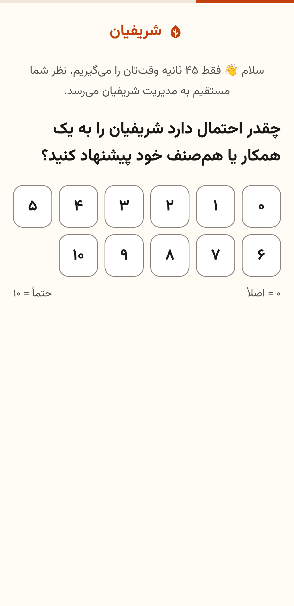
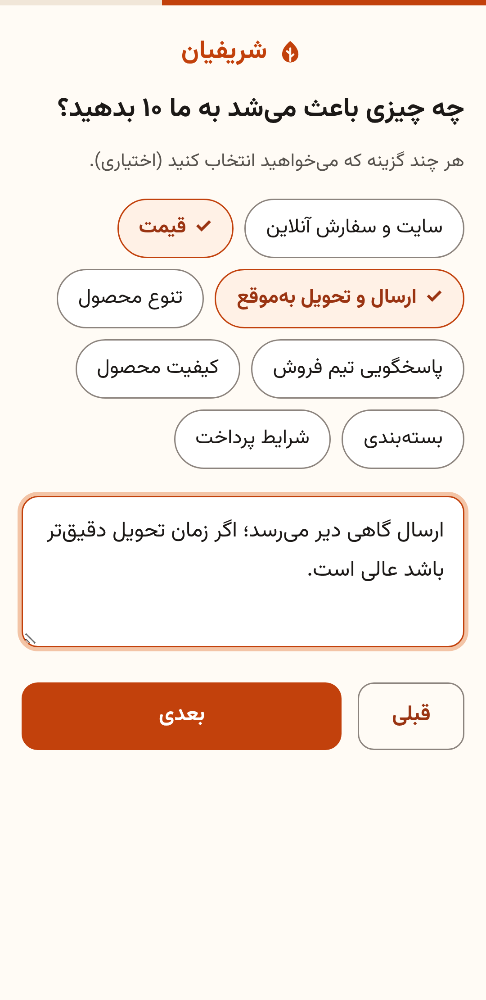
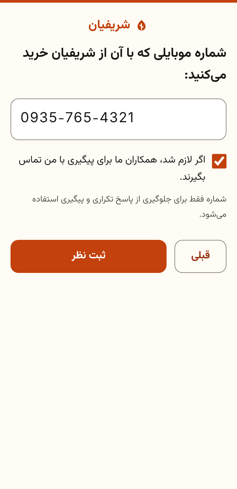
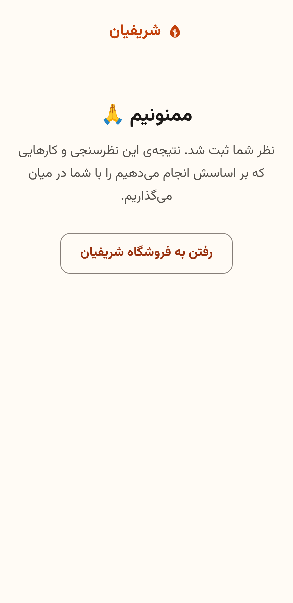
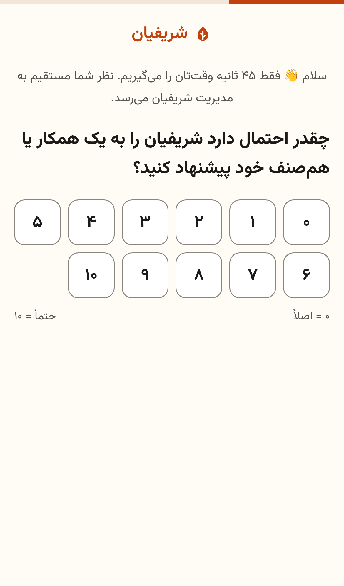
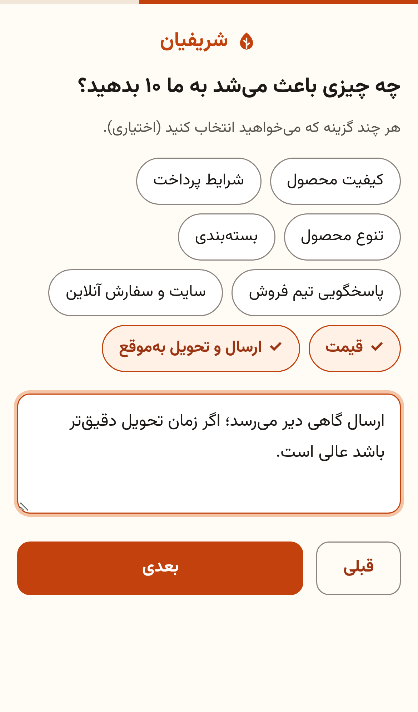
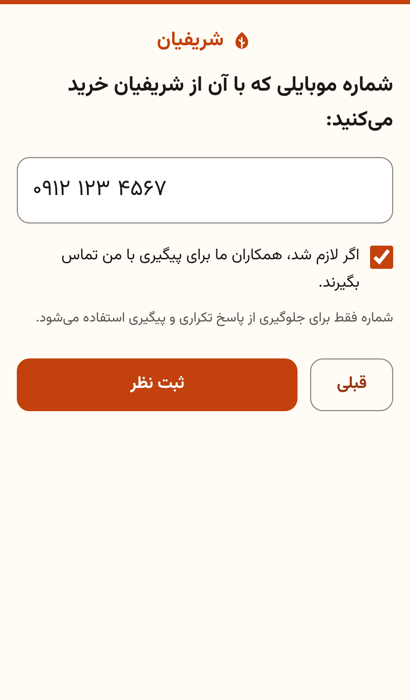
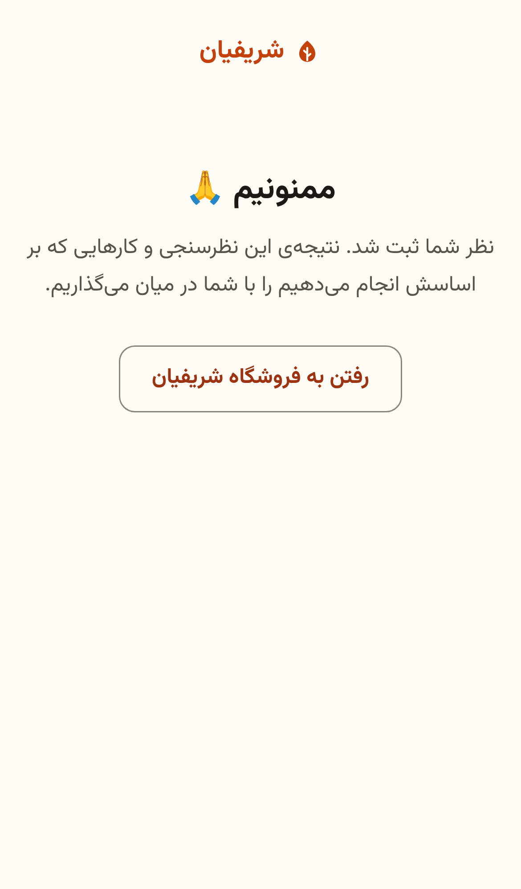
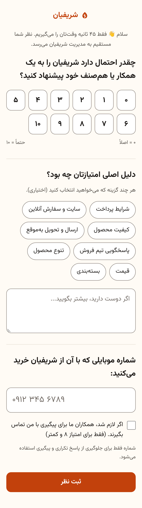
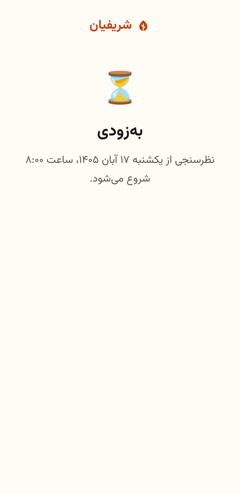

# فاز ۱ و ۲: گزارش چک‌پوینت

> **وضعیت: تمام شد، منتظر تأیید برای شروع فاز ۳ (داشبورد، seed دمو، نسخه‌ی چاپی).**
> هر تصمیمی که در سند نبود، در [`DECISIONS.md`](../DECISIONS.md) ثبت شده است (D58 تا D70 در همین دو فاز اضافه شدند).

## نتیجه‌ی تست‌ها

```text
npm run typecheck   → بدون خطا (TypeScript 7)
npm test            → 9 فایل، 152 تست، همه سبز (حدود 1.3 ثانیه)
```

| فایل | تعداد | چه چیزی را می‌سنجد |
|---|---|---|
| `tests/unit/mobile.test.ts` | ۳۰ | `normalizeMobile`: ارقام فارسی و عربی، ‎+98، ‎0098، ‎98، فاصله، خط تیره، نشانه‌های نامرئی، شماره‌ی کوتاه و بلند، حروف، تلفن ثابت |
| `tests/unit/nps.test.ts` | ۱۸ | مرزهای ۶/۷ و ۸/۹، ورودی نامعتبر، NPS و حاشیه‌ی خطا با جواب‌هایی که دستی حساب شده‌اند، و `n=0` که null می‌دهد (نه NaN) |
| `tests/unit/themes.test.ts` | ۱۲ | ی و ک عربی، نیم‌فاصله، «دیر» که نباید «مدیر» را بگیرد، فهرست‌های exact و exclude، و فایل `themes.json` واقعی |
| `tests/unit/csv.test.ts` | ۱۶ | BOM، UTF-16، windows-1256، جداکننده‌های `,` `;` تب و `؛`، ردیف خراب، خروجی امن در برابر فرمول، پارس لیست مشتریان |
| `tests/unit/date-fa.test.ts` | ۷ | تاریخ شمسی به وقت تهران، مرز نیمه‌شب تهران در مقابل UTC، نوروز ۱۴۰۵، فرمت عدد |
| `tests/unit/security.test.ts` | ۷ | rate limit با پنجره‌ی لغزان، امضا و جعل توکن، مقایسه‌ی constant-time، هش IP |
| `tests/unit/notify.test.ts` | ۴ | متن پیام هشدار بله، جابه‌جایی `chat_id`، و اینکه خطا یا timeout ثبت پاسخ را خراب نکند |
| `tests/integration/survey-api.test.ts` | ۳۷ | فرم، ثبت موفق (۲۰۱) با `category` و `customer_id` درست، تکراری (۴۰۹ و ثبت در `duplicate_attempts`)، بازه‌ی زمانی، honeypot، ثبت زیر ۳ ثانیه، توکن جعلی، rate limit، امتیاز نامعتبر، فرم بدون JS، Funnel، حالت آزمایشی، هدرهای امنیتی |
| `tests/integration/admin.test.ts` | ۲۱ | ریدایرکت یا ۴۰۱ بدون ورود، CSRF، کوکی امن، محدودیت تلاش برای رمز، پیش‌نمایش و ثبت CSV، مچ مجدد پاسخ‌های قدیمی، سه خروجی CSV با BOM، لینک‌ها، حذف، بکاپ |

## اندازه‌گیری‌ها (اسکریپت `npm run screenshots` روی Chromium)

| معیار | هدف | نتیجه |
|---|---|---|
| وزن کل صفحه‌ی فرم (HTML، CSS، JS و فونت، بعد از gzip) | کمتر از ۱۲۰KB | **۵۵٫۳KB** |
| JS صفحه‌ی فرم | کمتر از ۱۵KB | **۵٫۹KB** (۲٫۶KB با gzip) |
| اسکرول افقی در ۳۶۰px | صفر | **ندارد** (scrollWidth = 360) |
| درخواست به دامنه‌ی خارجی | صفر | **صفر** |
| سناریوی کامل: امتیاز، دلیل، موبایل، تشکر | — | روی iPhone 12 و اندروید ۳۶۰px تا صفحه‌ی تشکر رسید |
| کنتراست رنگ‌ها (WCAG AA) | متن ۴٫۵، کنترل ۳ | همه قبول (D70) |

## اسکرین‌شات‌ها (`docs/screenshots/`)

### موبایل، اندروید ۳۶۰px

| گام ۱: امتیاز | گام ۲: عنوان پویا برای امتیاز ۷ | گام ۳: موبایل و اجازه‌ی تماس | تشکر |
|---|---|---|---|
|  |  |  |  |

### iPhone 12

| گام ۱ | گام ۲ | گام ۳ (موبایل با ارقام فارسی) | تشکر |
|---|---|---|---|
|  |  |  |  |

### حالت‌های دیگر

| بدون جاوااسکریپت (هر سه گام در یک صفحه) | قبل از شروع کمپین |
|---|---|
|  |  |

دسکتاپ: [گام ۱ در یک ردیف](screenshots/05-step1-desktop.png) و [عنوان گام ۲ برای منتقد](screenshots/06-step2-detractor-desktop.png).

### پنل ادمین (فاز ۲)

- [ورود](screenshots/10-admin-login.png)
- [پیش‌نمایش ورود CSV با گزارش خطا](screenshots/11-admin-import-preview.png)
- [خانه‌ی پنل](screenshots/12-admin-home.png)
- [لینک کانال‌ها](screenshots/13-admin-links.png)

## اجرای محلی

```bash
cd sharifian-nps && npm install
```

```bash
npm run dev
```

بعد `http://localhost:3000` را باز کنید. پنل در `http://localhost:3000/admin` است و در حالت توسعه رمزش `admin` است. در حالت توسعه، اگر تاریخ‌های کمپین را تنظیم نکرده باشید، نظرسنجی از دیروز تا ۷ روز بعد باز است. برای تنظیمات واقعی، `.env.example` را به `.env` کپی کنید.

## تفاوت با ساختار فاز ۰

- `src/db/queries.ts` اسمش `src/db/repo.ts` شد.
- چند فایل اضافه شد:
  - `src/context.ts`: وابستگی‌های مشترکی که به routeها پاس داده می‌شوند.
  - `src/core/customers-csv.ts`: پارس خالص لیست مشتریان، که تست unit دارد.
  - `src/core/labels.ts`: برچسب‌های فارسی پنل.
  - `src/services/tokens.ts`: توکن فرم و لینک آزمایشی.
  - `scripts/test-server.ts`: سرور موقت برای اسکرین‌شات و بعداً E2E و تست بار.
  - `tests/helpers.ts`
- بکاپ: دانلود از پنل الان آماده است. اسکریپت `backup.sh` و اسنپ‌شات روزانه‌ی خودکار در فاز ۵ اضافه می‌شوند (D33).
- هشدار بله (فاز ۴) زودتر ساخته و تست شد، چون بخشی از مسیر ثبت پاسخ است. تست E2E آن با Playwright در فاز ۴ می‌آید.
