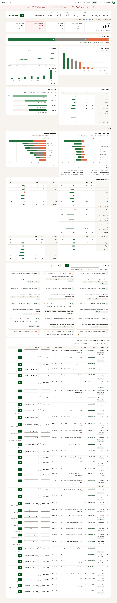
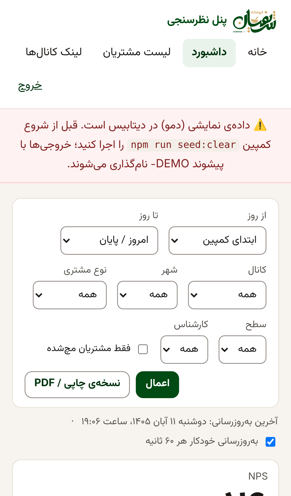
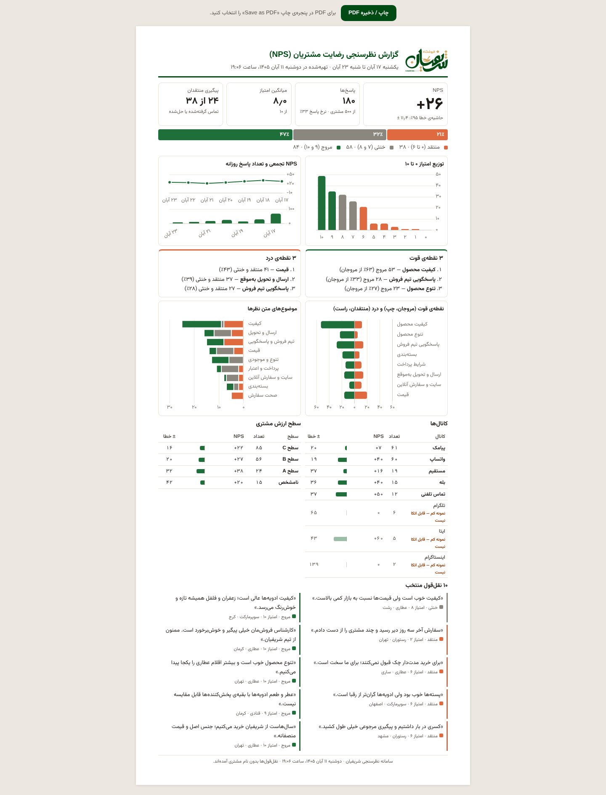

# فاز ۳ و ۴: گزارش چک‌پوینت

> **وضعیت: هر دو فاز تمام شد. منتظر تأیید برای شروع فاز ۵ (Dockerfile، liara.json، README.fa.md، بکاپ روزانه).**
> تصمیم‌های این دو فاز در [`DECISIONS.md`](../DECISIONS.md) با شماره‌ی D71 تا D86 ثبت شده‌اند.

## خلاصه‌ی نتیجه‌ها

| بخش | نتیجه |
|---|---|
| `npm run typecheck` | بدون خطا |
| `npm test` (unit و integration با Vitest) | ۱۱ فایل، **۱۷۹ تست سبز** |
| `npm run test:e2e` (Playwright روی سه پروفایل) | **۲۹ تست سبز**. ۱۰ تستِ «فقط دسکتاپ» روی دو پروفایل موبایل عمداً اجرا نمی‌شوند |
| دسترس‌پذیری (axe) | هیچ خطای critical یا serious در ۴ صفحه × ۳ پروفایل |
| `npm run test:load` (autocannon) | **PASS**: p95 فرم ۶۶ms، p95 ثبت ۷۱ms، صفر خطا |
| وزن صفحه‌ی فرم با لوگو | **۶۹٫۳KB** (سقف ۱۲۰KB)، صفر درخواست خارجی، بدون اسکرول افقی در ۳۶۰px |

## فاز ۳: داشبورد (`/admin/dashboard`)

| بخش سند | پیاده‌سازی |
|---|---|
| فیلتر سراسری | بازه‌ی روز (روزهای کمپین با تاریخ شمسی)، کانال، شهر، نوع مشتری، سطح، کارشناس، «فقط مچ‌شده». فیلترها در URL می‌مانند و لینک قابل‌اشتراک است |
| ردیف ۱: KPI | NPS بزرگ با حاشیه‌ی خطای ۹۵٪ و n؛ پاسخ‌ها از کل مشتریان و نرخ پاسخ؛ میانگین؛ منتقدان پیگیری‌نشده (قرمز با ⚠، به‌اضافه‌ی موارد بیش از ۴۸ ساعت)؛ میانه‌ی زمان تکمیل |
| ۱. نوار ۱۰۰٪ | نوار تقسیم‌شده با درصد داخل هر بخش و راهنمای رنگ |
| ۲. هیستوگرام ۰ تا ۱۰ | رنگ هر ستون بر اساس دسته |
| ۳. روند روزانه | دو نمودار هم‌محور: NPS تجمعی و تعداد پاسخ روزانه. بی‌دو‌محور، طبق D73 |
| ۴. کانال‌ها | جدول تعداد، NPS، نوار واگرا و حاشیه‌ی خطا؛ n کمتر از ۱۰ کم‌رنگ با برچسب «نمونه کم» |
| ۵. قیف | بازدید، انتخاب امتیاز، گام ۲، ثبت؛ با درصد از بازدید و ریزش هر مرحله |
| ۶. ماتریس عوامل | نمودار واگرا: مروجان به چپ، منتقدان به راست؛ به‌اضافه‌ی ۳ نقطه‌ی قوت و ۳ نقطه‌ی درد |
| ۷. سگمنت‌ها | چهار جدول (شهر، نوع، سطح، کارشناس) با برچسب نمونه‌ی کم |
| ۸. تحلیل متن | فراوانی موضوع‌ها به تفکیک دسته از روی `config/themes.json` |
| ۹. دیوار نظرات | جستجوی فارسی (حساس نیست به ی و ک عربی و نیم‌فاصله)، فیلتر دسته، ستاره برای نقل‌قول گزارش |
| ۱۰. پیگیری منتقدان | ترتیب: سطح A اول، بعد انتظار تماس، بعد قدیمی‌ترین؛ لینک `tel:`؛ وضعیت با dropdown که فوراً ذخیره می‌شود؛ یادداشت؛ نام و زمان ثبت‌کننده؛ برچسب «بیش از ۴۸ ساعت» |
| گزارش اجرایی | `/admin/report` در قطع A4: KPIها، نمودارها، ۳ قوت و ۳ درد، کانال‌ها و سطح‌ها، ۱۰ نقل‌قول بی‌نام. دکمه‌ی «چاپ / ذخیره PDF» |

داشبورد هر ۶۰ ثانیه خودکار تازه می‌شود (D77). زیر هر نمودار «جدول داده» هست (D76). رنگ‌ها با اسکریپت اعتبارسنجی پالت چک شده‌اند (D72).

**داده‌ی دمو.** `npm run seed:demo` این‌ها را می‌سازد: ۵۰۰ مشتری، ۱۸۰ پاسخ (۱۶۵ مچ‌شده و ۱۵ مچ‌نشده) و ۳۵۲ جلسه‌ی قیف با ریزش. زمان‌ها در روزهای کمپین پخش می‌شوند و متن‌ها فارسی‌اند. `npm run seed:clear` فقط ردیف‌های دمو را پاک می‌کند. روی دیتابیسی که داده‌ی واقعی دارد، seed اجرا نمی‌شود.

## فاز ۴

### E2E، روی Chromium با سه پروفایل: iPhone 12، اندروید ۳۶۰px، دسکتاپ

- سناریوی کامل مروج، خنثی و منتقد روی هر سه پروفایل. چک می‌شود:
  - عنوان پویای گام ۲
  - نمایش یا پنهان بودن چک‌باکس اجازه‌ی تماس
  - `dir="rtl"`
  - نبود اسکرول افقی در هر گام
  - رسیدن به صفحه‌ی تشکر
- **هشدار بله، سرتاسری.** سرور تست یک Bot API جعلی بله دارد. برای منتقد دقیقاً یک پیام با `chat_id` درست و «امتیاز ۳ از ۱۰» رسید؛ برای مروج و خنثی هیچ پیامی نرفت.
- شماره‌ی تکراری به `/already` می‌رود.
- دکمه‌ی قبلی و عوض کردن امتیاز، عنوان را به‌روز می‌کند. پیش‌نویس بعد از reload می‌ماند.
- شماره‌ی ثابت قبل از ارسال رد می‌شود.
- وزن صفحه زیر ۱۲۰KB است و هیچ درخواستی به دامنه‌ی خارجی نمی‌رود.
- فقط روی دسکتاپ:
  - کیبورد: جهت‌نما امتیاز را عوض می‌کند بی‌آنکه به گام بعد بپرد، و Enter به گام بعد می‌برد.
  - ثبت زیر ۳ ثانیه پیام دوستانه می‌دهد و تلاش بعدی موفق می‌شود.
  - فرم بدون جاوااسکریپت هم ثبت می‌کند.
- پنل:
  - پاسخ تازه در دیوار نظرات و لیست پیگیری دیده می‌شود.
  - وضعیت و یادداشت ذخیره می‌شوند و بعد از reload باقی‌اند.
  - جستجو کار می‌کند.
  - گزارش چاپی همه‌ی نمودارهایش را رسم می‌کند و خطای JS ندارد.

### تست بار (`npm run test:load`)

سرور در یک پروسه‌ی جدا اجرا شد و ۵۰۰ موبایل یکتا با توکن معتبر فرستاده شد.

| سناریو | درخواست | req/s | p50 | p95 | p99 | max | خطا | non-2xx |
|---|---|---|---|---|---|---|---|---|
| فرم: ۱۰۰ کاربر هم‌زمان به مدت ۱۰ ثانیه | ۲۱٬۶۶۲ | ۲٬۱۶۶ | ۳۸ms | ۶۶ms | ۷۳ms | ۲٬۹۵۲ms | ۰ | ۰ |
| ثبت: ۵۰ اتصال هم‌زمان، ۵۰۰ ثبت | ۵۰۰ | ۵۰۰ | ۵۰ms | ۷۱ms | ۷۶ms | ۷۹ms | ۰ | ۰ |

یک درخواست تکی در سناریوی فرم ۲٫۹ ثانیه طول کشید (ستون max). p99 همان سناریو ۷۳ms است، پس این یک مورد استثنایی است، احتمالاً توقف GC یا گرم شدن ماشین تست.

## اسکرین‌شات‌ها

| داشبورد (دسکتاپ، داده‌ی دمو) | داشبورد روی iPhone 12 | گزارش چاپی |
|---|---|---|
|  |  |  |

- خروجی PDF گزارش: [`21-report-a4.pdf`](screenshots/21-report-a4.pdf)
- اسکرین‌شات‌های فرم و پنل با لوگو و رنگ جدید دوباره گرفته شدند: `01` تا `13` در همان پوشه.

## دیدن داشبورد روی سیستم خودتان

پیش‌نیاز: Node.js نسخه‌ی ۲۲٫۱۸ یا جدیدتر (یا ۲۴).

```bash
git clone -b claude/new-session-w5sy21 https://github.com/awrashsajjadi/playground.git
```

```bash
cd playground/sharifian-nps
```

```bash
npm install
```

```bash
npm run seed:demo
```

```bash
npm run dev
```

بعد `http://localhost:3000` (فرم) و `http://localhost:3000/admin/dashboard` (داشبورد) را باز کنید. رمز در حالت توسعه `admin` است. سرور آدرس شبکه‌ی محلی را هم چاپ می‌کند تا فرم را روی گوشی‌ای که به همان وای‌فای وصل است باز کنید.

## نکته‌ها

- بعد از این گزارش، اجرای «کلون تازه → `npm install` → `npm run seed:demo` → `npm run dev`» امتحان شد. `npm run dev` روی کپی‌ای که `.env` نداشت کرش می‌کرد. برطرف شد (D89). حالا سرور بعد از بالا آمدن آدرس فرم، داشبورد و آدرس شبکه برای گوشی را چاپ می‌کند (D88).
- E2E فقط روی Chromium اجرا شد، با شبیه‌سازی iPhone. Safari واقعی در این محیط نصب نیست. تست با WebKit با یک خط در `playwright.config.ts` فعال می‌شود.
- ~~اگر بازه‌ی کمپین هنوز نرسیده باشد، تاریخ پاسخ‌های دمو در آینده است.~~ برطرف شد (D87). در حالت توسعه، کمپین از ۵ روز پیش شروع شده فرض می‌شود و داده‌ی دمو فقط تا همین لحظه ساخته می‌شود. پیگیری‌های «بیش از ۴۸ ساعت» هم در دمو دیده می‌شوند.
